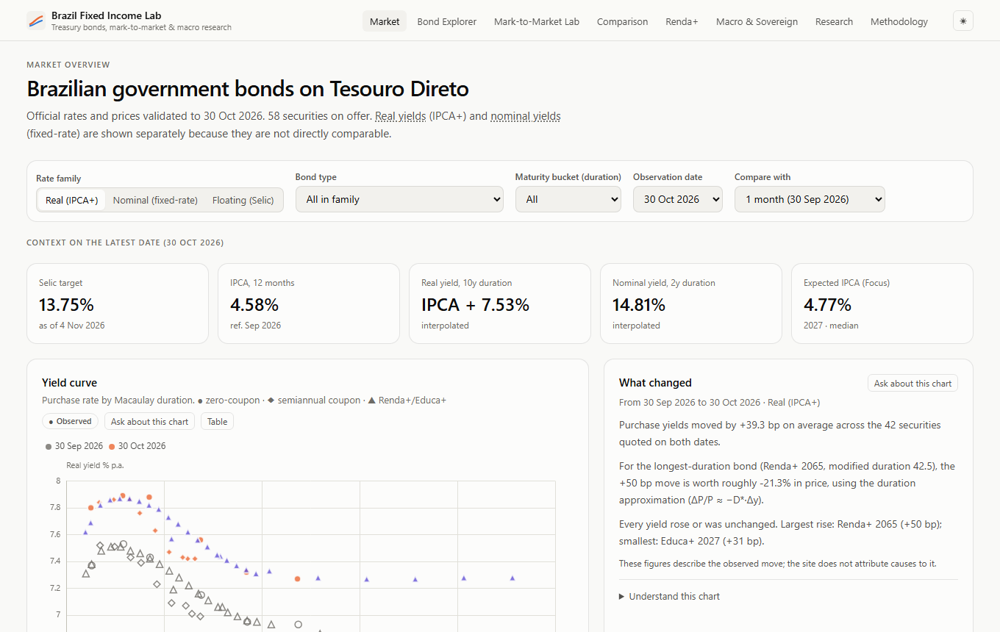
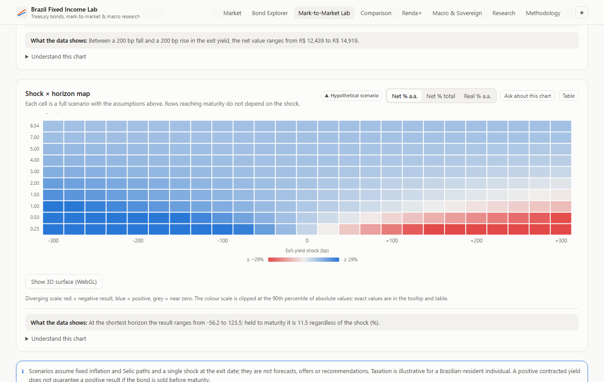
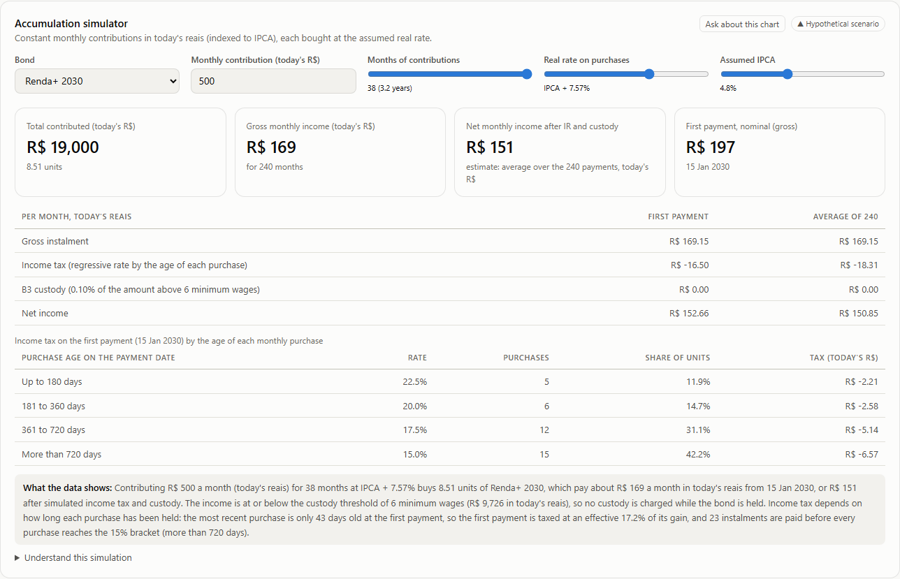

# Brazil Fixed Income Lab

**Treasury bonds, mark-to-market and macroeconomic research for Brazil.**

Live site: **https://leobobadilha.github.io/brazil-fixed-income-lab/**

A data engineering and financial analytics project on Brazilian government bonds (Tesouro Direto). A Python and DuckDB pipeline collects official data, validates it and prices every bond with an engine that follows Tesouro Nacional's published methodology. A static React site then turns the results into interactive analysis, with an explanation of what each chart means and what it cannot show.



## What problem it solves

Official Brazilian bond data is public, but it is spread across several sources and is hard to interpret. The mistakes it invites are easy to make: comparing real and nominal yields directly, reading a positive yield as a guaranteed result, or treating a historically high rate as a cheap bond. This project:

- reconciles a pricing engine against every published price, so the numbers can be trusted;
- separates what was observed, what is theoretical and what is a hypothetical scenario;
- shows the effect of costs and taxes, and states the assumptions behind them.

## Key capabilities

| Page | What it does |
|---|---|
| **Market** | Real and nominal yield curves, changes between any two dates, benchmark history, all bonds on offer |
| **Bond Explorer** | Rate and price history, price–yield relationship, duration, convexity, volatility, cash flows, peers for any security |
| **Mark-to-Market Lab** | From any historical date with no look-ahead: observed results, instant repricing with duration and convexity, holding-period scenarios after custody, income tax and IOF, and a shock × horizon map |
| **Comparison** | Up to three investments under identical inflation and Selic assumptions |
| **Renda+** | Retirement-income planning: 240-payment structure, accumulation simulator with income tax applied purchase by purchase, early-sale outcomes |
| **Macro & Sovereign** | Selic, inflation, Focus expectations, real rates, gross and net debt, fiscal balances, debt composition and maturity |
| **Research** | Hypotheses tested with multiple-testing correction and out-of-sample checks, percentiles, regimes, drawdowns |
| **Methodology** | Data freshness, evidence behind each check, reconciliation statistics, quality checks |

Every chart has a short explanation that updates with the filters, and an **Ask about this chart** panel. The panel is a curated question-and-answer system: answers are written by hand, scoped to the chart and bond on screen, and matched by keywords. It is not an LLM.

| Scenario map | Renda+ income by purchase age |
|---|---|
|  |  |

## Architecture

```
Tesouro Transparente      BCB SGS and Focus      IBGE SIDRA
        └──────────────┬───────┴───────────────────┘
                 Extraction          timeouts, retries, checksums, manifest, incremental updates
                       │
                 Validation          schema guard, blocking and warning quality checks
                       │
               Transformation        types, security identifiers, calendars
                       │
                    DuckDB           local analytical store, swapped atomically
                       │
              Financial modelling    official pricing, reconciliation, risk measures, scenarios
                       │
                   Research          statistical tests, constant-duration benchmarks
                       │
              Published datasets     versioned JSON snapshot, swapped atomically
                       │
                 React website       TypeScript engine, ECharts, static hosting
```

If a blocking check fails, nothing is published and the last valid snapshot stays online.

**Stack:** Python, pandas, NumPy, DuckDB · React, TypeScript, Vite, Tailwind CSS, ECharts, Three.js (optional 3D view, lazy-loaded) · pytest, Vitest, Playwright, axe · GitHub Actions, GitHub Pages. No backend, paid service or API key.

## Numerical validation

The pricing engine covers LTN, NTN-F, LFT, NTN-B Principal, NTN-B and NTN-B1 (Renda+ and Educa+), including Tesouro's truncation rules, the business-day calendar in force on each date, and settlement conventions.

| Evidence | Result | Type |
|---|---|---|
| Tesouro's published worked examples and 300 business-day counts | Reproduced exactly | Independent |
| LTN prices recomputed from published rates (84,771) | 99.78% to the cent | Independent prediction |
| NTN-F prices (82,211) | 99.56% to the cent | Independent prediction |
| IPCA-linked prices (255,064 across NTN-B, NTN-B Principal, Renda+ and Educa+) | 98.8–99.8% to the cent | Consistency: the updated nominal value is inferred from the same day's prices |
| Updated nominal value rebuilt from IBGE and BCB data | Within a few basis points | Independent inputs, with a proxy for the current month's projection |
| Tesouro Selic (LFT) | 71.4% to the cent | Limited: since 2020 the published spread has only 2 decimals, so the typical error is about R$ 0.50 on a R$ 20,000 price |

In total 486,545 official prices are recomputed. Residual differences stay visible on the Methodology page.

Costs and taxes are checked against hand-computed reference cases (`tests/fixtures/`), written independently of the engines. The browser engine matches the Python engine to 10⁻⁹ across 49 full scenarios.

## Data provenance and quality

- **Sources:** Tesouro Transparente (prices, rates, federal debt stock), Banco Central do Brasil (SGS series, Focus survey), IBGE (IPCA index).
- **Rules:** duplicate keys, out-of-range rates, quotes after maturity, shrinking history, future-dated series and reconciliation below its threshold all block publication.
- **Freshness:** thresholds per source cadence; market observation, source publication, last fetch, snapshot build and deployment dates are kept apart.
- **Licences:** code MIT ([LICENSE](LICENSE)); derived datasets ODbL 1.0 with attribution ([DATA_LICENSE.md](DATA_LICENSE.md)).

## Run it locally

Requires Python 3.11+ and Node 22.

```bash
python -m venv .venv
source .venv/bin/activate                  # Windows: .venv\Scripts\activate
pip install -r requirements-dev.txt
python -m pytest                           # tests run against the included snapshot

cd web
npm ci
npm run dev                                # http://localhost:5173/brazil-fixed-income-lab/
npm test                                   # unit tests
npm run build && npx playwright install chromium && npx playwright test
```

To refresh the data from the official sources, run `python -m src.pipeline` from the repository root. It downloads, validates, prices and republishes the datasets into `web/public/data`. Nothing else is needed: the sources are open and require no key.

## Tests and CI

118 Python tests (114 pass; 4 are not applicable to coupon bonds), 84 TypeScript tests and 60 browser tests across desktop and mobile. GitHub Actions runs everything on each push. Covered: official fixtures, hand-computed cost and tax cases, mathematical properties, Python/TypeScript parity, freshness rules, data-refresh behaviour on failure, Q&A scope and number provenance, English-only content, accessibility and mobile layout.

## About this repository

This is a **source snapshot** for review, version 1.0.0, with data as of 2026-10-30. The live site is built and refreshed from a separate operational repository, so the site's data can be newer than this snapshot, and this repository is not automatically kept in sync. The deployment and data-refresh jobs are included for reference and run only there; here, Actions runs the tests.

More detail: [methodology](docs/methodology.md) · [chart inventory](docs/chart-inventory.md) · [explanations and Q&A design](docs/explanations-and-qa.md) · [browser LLM assessment](docs/browser-llm-feasibility.md) · [visual design](docs/design.md)

## Limitations

- Simulations are educational. They use documented assumptions, are not forecasts or personal advice, and no result is guaranteed.
- Tax and custody rules are illustrative for a Brazilian-resident individual, versioned in `config/assumptions`. Two points are not confirmed by official sources and are labelled as assumptions: whether custody reduces the income-tax base (by default it does not), and how purchase cost is split across Renda+ instalments.
- Tesouro Direto publishes one morning quote per day, so intraday moves are not captured.
- The IPCA projection Tesouro uses is not open data; the independent check uses realised inflation as a proxy.
- Tesouro IGPM+ (NTN-C) is shown as observed data only.

Built with AI coding assistance; the financial results are checked against official data and worked examples.
